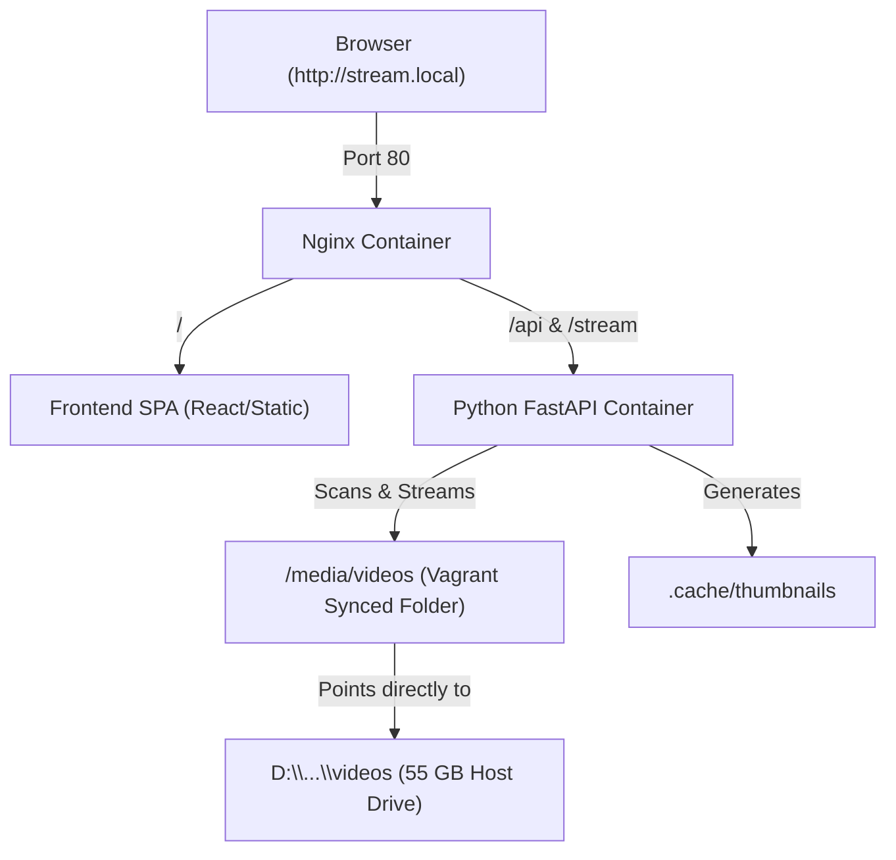

# Video Streaming Platform Architecture & Implementation Plan

Based on your background in DevOps / Build & Release Engineering and your specific setup requirements, we have tailored the architecture to be clean, resource-efficient, and great for learning.

---

## Technical Stack & Architecture

### 1. Zero-Copy Storage Handling (Vagrant Synced Folders)
* **Problem:** Copying 55 GB of videos into the VM is slow and wastes disk space.
* **Solution:** We will use a **Vagrant Synced Folder** to mount `the media folder` directly to `/media/videos` inside the Ubuntu VM.
* **Docker Mount:** Docker Compose will bind-mount `/media/videos` into the backend & Nginx containers. No files need to be copied!

### 2. Backend (Python / FastAPI)
* Since you know Python, **FastAPI** is ideal. It supports async file streaming out of the box with HTTP `Range` headers (enabling seeking/scrubbing).
* **Automatic Thumbnail Generation:** On startup (or folder scan), the backend will use `ffmpeg` to capture a frame at 5 seconds into each video and save a thumbnail JPEG.
* **Metadata API:** Scans the folder and returns a list of video files with titles, duration, and thumbnail URLs.

### 3. Frontend (Modern Web UI - React + Vite)
* A modern, sleek dark-mode UI with smooth cards for each video.
* Clicking a card opens a modal or video player view using custom HTML5 / Video.js.
* Modern aesthetics (glassmorphism, clean grid layout, smooth animations).

### 4. Reverse Proxy & Hostname / Local DNS (Nginx)
* **IP & Hostname:** We'll set the VM to a static private IP (e.g. `<vm-address>`).
* **Local DNS:** You can map `<vm-address> stream.local` in your Windows `hosts` file (`C:\Windows\System32\drivers\etc\hosts`).
* Access your stream via `http://stream.local` in any browser on your machine!
* **Nginx:** Handles requests on port 80, proxying `/api` to FastAPI and serving the Frontend web app.

---

## System Diagram

---

## Implementation Steps

### Step 1: Host Video Inspection & Codec Check
* Run a quick check on your host machine to verify video codecs (H.264 check).

### Step 2: Vagrant & VM Provisioning
* Create `Vagrantfile`:
  * Ubuntu 22.04 LTS (`ubuntu/jammy64`).
  * Private network IP: `<vm-address>`.
  * Synced folder: the media folder -> `/media/videos`.
* Write `bootstrap.sh` provision script:
  * Install Docker Engine, Docker Compose, and `ffmpeg`.

### Step 3: Backend API (FastAPI + FFmpeg)
* Create `backend/` directory:
  * `main.py`: Video library scanner, thumbnail generator, HTTP range streaming endpoint.
  * `Dockerfile` for the Python service.

### Step 4: Frontend Web Application
* Create `frontend/` directory:
  * Sleek video grid UI with thumbnail previews, search filter, and responsive HTML5 player.
  * `Dockerfile` for production build or static serving.

### Step 5: Nginx & Docker Compose Setup
* `nginx.conf`: Reverse proxy routing configuration.
* `docker-compose.yml`: Wire up Nginx, Backend, Frontend, and volume mounts.

### Step 6: Local DNS Setup & Verification
* Instructions to add `<vm-address> stream.local` to Windows `hosts`.
* Test video playback, scrubbing, thumbnail generation, and overall UI responsiveness.

---

## Verification Plan

### Automated & Manual Testing
1. **VM Verification:** `vagrant up` completes, Docker is installed, and `/media/videos` lists all your host video files.
2. **Docker Stack Verification:** `docker compose up -d` brings up Nginx, Backend, and Frontend containers cleanly.
3. **Thumbnail Generation Verification:** FastAPI backend scans the mounted directory and creates thumbnails.
4. **Playback Verification:** Navigate to `http://stream.local` in your browser. Verify video listing, thumbnail loading, smooth playback, and seeking/scrubbing.
